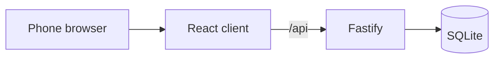

# GPS Tag

A phone game of infection tag. One player starts as the catcher. Catchers scan a runner’s QR code, or enter a short code, and that runner becomes a catcher too. A north-up street map shows a 20 metre radius and refreshes about every five seconds. The nearby-player list covers 500 metres. The Map button opens a full-screen street map of everyone in the active game.

The app is one Node process: a React interface and a Fastify API, with the game stored in SQLite. It needs Node 22 or newer.

The trial deployment is <https://gps-tag-production.up.railway.app>. The same site serves a [project write-up](https://gps-tag-production.up.railway.app/writeup) at `/writeup`.

## Game modes

**Classic tag** is the game at `/`. The host sets a round length, starts the chase, and catchers convert runners by QR or code. GPS is optional; a player without it is simply missing from the radar.

**Capture the Flag** is a separate mode at `/capture-the-flag`. The host places three flags near a fixed start, then a 30-minute round begins. Runners capture a flag by staying within 15 metres of it; catchers still tag by QR or code. Rooms, cookies, tables, and routes are isolated from classic tag. Rules and setup are in [docs/capture-the-flag.md](docs/capture-the-flag.md).

## How to play

- The creator is the host and the first catcher.
- Other players can join only before the game starts.
- The host starts once at least two people have joined.
- A catcher tags a runner by QR or six-character code. The same runner cannot be scored twice.
- The host chooses a time limit from 30 minutes to 6 hours, in 30-minute steps (default: 30 minutes). The duration locks when the chase starts. The server enforces the deadline even when phones are locked or disconnected; refreshing does not reset it. The host can still end the round early. Catch every runner before the countdown reaches zero, or the remaining runners win.
- The game also ends when no runners remain, or when the host ends it.
- Players can exit a waiting room or a running game to return home and stop sharing GPS. A running game cannot be rejoined after exiting.
- When the host exits, a waiting room closes for everyone. A running game ends and the remaining players see results.
- Mid-game departures keep their earned tags in the results, labeled “Left game”, and do not count as survivors. Play ends if departures leave no runners or no catchers.
- A browser can resume its game until it exits or the game ends. Exit or finish the current game before joining another.
- Refreshing resumes the signed browser session. Clearing site data starts a new player.

Keep the page open and visible while you play. Mobile browsers pause timers, GPS, and the camera when the phone locks or the tab is hidden. The app does not track anyone in the background.

## Quick start

```bash
npm install
npm run local
```

Open <http://localhost:5173>. No environment file is required. The API listens on port 3001, Vite proxies `/api`, and the database is created at `.data/game.sqlite`.

Browsers only expose location and the camera on `https://` pages or `http://localhost`. A phone opening a laptop’s plain HTTP address cannot grant those permissions. Use the deployed HTTPS address for a real game.

## Scripts

| Command | What it does |
| --- | --- |
| `npm run local` | API and Vite together, for development |
| `npm test` | Vitest |
| `npm run typecheck` | Typecheck the client and the server |
| `npm run build` | Production client and server build |
| `npm start` | Serve the production build |

`npm start` requires `COOKIE_SECRET` when `NODE_ENV=production`. GitHub Actions runs typecheck, test, and build on Node 22.

## Configuration

Local development needs none of these. Safe defaults apply.

| Variable | Default | Purpose |
| --- | --- | --- |
| `COOKIE_SECRET` | A fixed dev secret; required in production (at least 32 characters) | Signs the player session cookie |
| `PORT` | `3001` in development, `3000` in production | Port the API listens on. Railway sets this |
| `HOST` | `0.0.0.0` | Bind address |
| `DATA_DIR` | `./.data` locally, `/data` in the Docker image | Directory for `game.sqlite` |
| `RAILWAY_VOLUME_MOUNT_PATH` | Unset | When set, overrides `DATA_DIR` |
| `COOKIE_SECURE` | `true` in production, otherwise `false` | Sets the cookie `Secure` flag. Use `false` for plain HTTP |
| `API_PORT` | `3001` | Port Vite proxies `/api` to during `npm run local` |
| `CTF_OVERPASS_URL` | `https://overpass-api.de/api/interpreter` | Landmark lookup for Capture the Flag. An empty string disables lookup; the host places flags by hand |
| `VITE_MAP_TILE_URL` | OpenStreetMap `{z}/{x}/{y}` tiles | Tile template. Set at build time, together with the attribution below |
| `VITE_MAP_TILE_ATTRIBUTION` | OpenStreetMap copyright link | Attribution HTML for the tile layer |

Generate a production secret with `openssl rand -hex 32`. Do not commit a real `COOKIE_SECRET`.

## Architecture



One process serves both in production. In development, Vite serves the client and proxies `/api` to the API.

| Path | Role |
| --- | --- |
| `server/` | Fastify app, classic game routes, SQLite schema and migrations |
| `server/ctf/` | Capture the Flag routes, rules, and landmark lookup |
| `src/` | Classic tag interface |
| `src/ctf/` | Capture the Flag interface, loaded only at `/capture-the-flag` |
| `src/location/provider.ts` | Sensor acquisition, separate from upload and radar behaviour |
| `tests/` | API, client, map, migration, and Capture the Flag tests |

## Deploy

### Docker

```bash
docker compose up --build
```

The production-shaped app is at <http://localhost:3000>. Its database stays in the `game-data` volume, mounted at `/data`. Set `COOKIE_SECRET` in the shell to override the local Compose default. Compose sets `COOKIE_SECURE=false` because this local URL is HTTP.

### Railway

1. Create a project from this repository. `railway.toml` selects the Dockerfile and `/health`.
2. Set `COOKIE_SECRET` to at least 32 random characters.
3. Add one volume mounted at `/data`. The database file is `/data/game.sqlite`.
4. Keep the service at exactly one replica. SQLite on a volume cannot be shared by multiple instances.
5. Deploy and open the HTTPS URL.

Volume-backed deploys stop the old instance before the new one starts, so expect a brief interruption. Without the volume, every deploy starts with an empty database. Railway can snapshot the volume; that is the backup for a trial deployment.

The service must be reached through Railway’s public HTTPS proxy. That proxy overwrites `X-Real-IP`, which is what anonymous rate limits use. Do not add another service on the same private network that calls this port: private callers can forge that header. Direct public access to the container port is not part of the setup.

## Privacy and data retention

Location sharing stores only the latest fix. It is cleared when the round ends, and games older than 24 hours are deleted. Capture the Flag clears live coordinates when a round ends, keeps ended rooms for 24 hours, and removes abandoned waiting rooms after 24 hours. Checkpoint and start locations are removed with the room.

How uploads, uncertainty, and the full map behave is in [docs/location-and-map.md](docs/location-and-map.md).

## Further reading

- [Capture the Flag](docs/capture-the-flag.md) — rules, isolation from classic tag, and landmark lookup
- [Location and map](docs/location-and-map.md) — GPS behaviour, the location protocol, and map tiles
- [Roadmap and testing](docs/roadmap-and-testing.md) — native location and Bluetooth plans, and device checks
